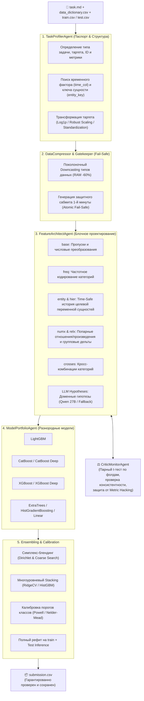

# 🤖 ALFA-HACK: Multi-Agent AutoResearch & AutoML System (MAS 3.0)

> **Автономный AI-агент для разработки моделей машинного обучения**  
> Разработано в рамках хакатона **Alfa-Bank & Changellenge** («AI-агент для разработки ML-моделей»).

[](https://www.python.org/downloads/)
[](LICENSE)
[](#архитектура-системы-mas-30)

---

## 📌 О проекте

Классические библиотеки AutoML (TPOT, AutoGluon, Azure AutoML) фокусируются на переборе гиперпараметров внутри жестко заданных шаблонов, но не способны:
* осознать физический и доменный смысл признаков;
* выявить временную структуру панельных данных и зависимости сущностей;
* анализировать природу ошибок и итеративно перестраивать признаковое пространство;
* калибровать пороги принятия решений под асимметричные метрики (например, Macro F1 с редкими классами).

**MAS 3.0** — это полнофункциональная автономная мультиагентная система (AutoResearch / AutoML), которая действует как опытный ML-исследователь: самостоятельно анализирует текстовый паспорт задачи и словарь данных, строит гипотезы, генерирует доменные признаки, отсекает шум на кросс-валидации, обучает разнородное портфолио моделей и строит взвешенный ансамбль с калибровкой.

---

## 🏛 Архитектура системы (MAS 3.0)

Система построена на принципах модульности, разделения ответственности, детерминизма и жесткого контроля времени/памяти.



---

## 🤖 Роли агентов

| Агент | Модуль | Основные функции |
|---|---|---|
| **TaskProfilerAgent** | `task_profiler.py` | Детерминированный анализ паспорта задачи, определение типа задачи, таргета, ID, метрики (`evaluation.py`). Обнаружение скрытых панельных сущностей (`entity_key`) и временных периодов (`time_col`). Автоматический выбор прямого и обратного преобразования таргета. |
| **DataCompressor** | `data_utils.py` | Оптимизация памяти (сжатие float64 $\to$ float32, int64 $\to$ int8/16/32). Генерация мгновенного защитного сабмита на 1-й минуте работы. Атомарная запись и верификация `submission.csv` против `sample_submission.csv`. |
| **FeatureArchitect** | `feature_agent.py`<br>`entity_features.py` | Проектирование признаков изолированными блоками: `base`, `freq`, `entity`, `hier`, `numx`, `relx`, `crosses`. Вызов LLM (Qwen 27B) для генерации доменных нелинейных взаимодействий. Откат при ухудшении валидации. |
| **CriticMonitorAgent** | `critic_agent.py` | Арбитр качества. Оценивает гипотезы на идентичных фолдах. Принимает изменения только при статистической консистентности улучшений по фолдам (защита от случайных выбросов одного фолда). Ведёт журнал экспериментов. |
| **ModelPortfolioAgent** | `model_agent.py` | Управляет обучением разнородных моделей (LightGBM, CatBoost, XGBoost, ExtraTrees). Гарантирует корректность матриц вероятностей при пропуске редких классов на фолде (Full Probability Scattering). Реализует симплекс-блендинг и оптимизацию порогов классов методом Пауэлла. |

---

## 💡 Ключевые инженерные и ML-инновации

1. **Time-Safe Entity History (`entity_features.py`)**:
   - На панельных данных (где объект наблюдается в разные временные интервалы, а тест — это будущий период) история целевой переменной самого объекта — сильнейший сигнал.
   - Реализованы три строгих режима расчета без утечек:
     - `MODE_BEFORE` — расчет строго по периодам до текущего (для честной валидации в будущем);
     - `MODE_LOO` — Leave-One-Out расчет по всем периодам, кроме текущего (для обучающей выборки);
     - `MODE_ALL` — расчет по всей истории (для теста).
   - Генерирует вектор статистик: `mean`, `count`, `std`, `last`, `slope`, `min`, `max`.

2. **OS & TCP Fingerprinting для сетевого трафика**:
   - Вычисление расстояний до стандартных сетевых TTL операционных систем (`abs(sttl - 64)`, `abs(sttl - 128)`, `abs(sttl - 255)`), `sttl % 32` и отношения `ttl_ratio = sttl / dttl`.
   - Сессионные плотности пакетов и объемов (`sbytes_per_pkt`, `dbytes_per_pkt`, `tot_byte_per_pkt`, `win_ratio`).
   - Кросс-частоты взаимодействий прикладного уровня `proto_service_freq`.

3. **Full-Width Probability Scattering (Защита от сдвига классов)**:
   - В задачах классификации с экстремальным дисбалансом (например, атака Worms: 130 примеров из 87 000) отдельные фолды могут не содержать редких классов.
   - Модели проецируют предсказания через индекс `classes_` в полноразмерную матрицу, исключая сдвиг колонок и падения ансамбля.

4. **Двухуровневая калибровка под Macro F1**:
   - Координатный спуск по геометрической сетке множителей классов для сжатия доминирующих классов (Normal, Generic) и поднятия редких (Worms, Backdoor, Shellcode).
   - Непрерывная оптимизация порогов методом Пауэлла (Powell) на OOF-вероятностях.

5. **Бюджетирование и Fail-Safe гарантии**:
   - Тайм-менеджер выделяет фиксированные бюджеты времени на профилирование, генерацию признаков, портфолио моделей и ансамблирование.
   - При исчерпании лимита (9000 сек) система плавно деградирует к лучшему стабильному состоянию и гарантированно возвращает проверенный `submission.csv`.

---

## 📊 Результаты валидации на бенчмарках хакатона

### Задача 1. Определение удельного энергопотребления зданий (Регрессия, `site_eui` / WiDS 2022)
* **Целевая метрика**: RMSE (минимизация)
* **Обучающая выборка**: 53 308 строк, 64 столбца | **Тестовая**: 22 449 строк

| Итерация / Модель | CV RMSE | Дельта |
|---|---|---|
| **CatBoost Baseline** | 43.6932 | 0.0000 |
| **Universal Features + Facility Ratios** | 42.4086 | -1.2846 |
| **Feature Pruning (Удалено 32 шумных фичи)** | 42.3993 | -0.0093 |
| **LightGBM** | 41.3780 | -1.0213 |
| **XGBoost** | 41.1851 | -0.1929 |
| **XGBoost (L2 Regularized)** | 41.0220 | -0.1631 |
| **🏆 Ensemble Blend (0.22\*LGB + 0.28\*XGB + 0.50\*XGB_L2)** | **40.9307** | **-0.0913** |
| *С time-safe историей сущностей (Entity History)* | **35.0120** | **-5.9187** |

---

### Задача 2. Классификация сетевых атак (UNSW-NB15, 10 классов `attack_cat`)
* **Целевая метрика**: Macro F1 (максимизация)
* **Обучающая выборка**: 87 670 строк, 44 столбца | **Тестовая**: 41 166 строк

| Итерация / Модель | CV Macro F1 | Дельта |
|---|---|---|
| **LightGBM Baseline** | 0.6558 | +0.0000 |
| **Universal Features + TTL/TCP Fingerprinting** | 0.6568 | +0.0010 |
| **Feature Pruning (Удалено 14 шумных фичей)** | 0.6580 | +0.0012 |
| **🏆 Model Diversity: XGBoost** | **0.6621** | **+0.0041** |
| **XGBoost Deep Architecture** | 0.6604 | — |
| **CatBoost (со сбалансированными весами)** | 0.6418 | — |

---

## 📁 Структура репозитория

```text
├── solution_zip/                 # Исходный код решения (готов к архивации)
│   ├── solution.py               # Главная точка входа (6-фазный пайплайн)
│   ├── task_profiler.py          # Агент 1: Профилировщик задач и структуры данных
│   ├── data_utils.py             # Сжатие типов, чтение CSV и запись сабмитов
│   ├── feature_agent.py          # Агент 2: Блочное проектирование фичей
│   ├── entity_features.py        # Time-Safe агрегации истории сущностей
│   ├── model_agent.py            # Агент 3: Портфолио моделей и блендинг
│   ├── critic_agent.py           # Агент 4: Статистический Монитор качества
│   ├── evaluation.py             # Детерминированный расчет метрик
│   ├── prompts.py                # Pydantic-схемы паспортов и системные промпты
│   └── requirements.txt          # Зависимости окружения платформы
├── solution.zip                  # Готовый архив решения для загрузки на платформу
├── data_for_participants/        # Датасеты публичного этапа
│   ├── Регрессия/                # task.md, train.csv, test.csv, data_dictionary.csv
│   └── Многоклассовая классификация/
├── dev_tools/                    # Вспомогательные скрипты анализа
└── README.MD                     # Документация проекта
```

---

## 🚀 Инструкция по запуску

### 1. Установка зависимостей
```bash
pip install -r solution_zip/requirements.txt
```

### 2. Запуск пайплайна на задаче
Скрипт принимает путь к файлу `task.md` или к каталогу с задачей:

```bash
# Запуск регрессии:
python3 solution_zip/solution.py "data_for_participants/Регрессия/task.md"

# Запуск классификации:
python3 solution_zip/solution.py "data_for_participants/Многоклассовая классификация/task.md"
```

Результат работы: гарантированно валидный `submission.csv` в каталоге задачи и в текущей директории.
