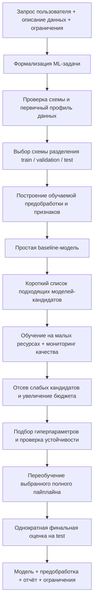

# Общая схема и спецификация ML-пайплайна

## 1. Общая схема процесса



---

### 1.1. Что агент должен извлекать из контекста

До начала обучения агент обязан сформировать структурированный **паспорт эксперимента**:

```yaml
task:
  type: regression | classification | anomaly_detection | clustering
  target: null
  prediction_unit: null
  prediction_time: null
  prediction_horizon: null
data:
  modality: tabular
  entity_id: null
  time_column: null
  target_available: false
evaluation:
  primary_metric: null
  metric_direction: maximize | minimize
  quality_threshold: null
  critical_segments: []
  error_costs: null
resources:
  search_budget_seconds: null
  final_fit_budget_seconds: null
  memory_limit_gb: null
  cpu_limit: null
  gpu_allowed: false
sampling:
  confidence_level: 0.95
  acceptable_error: null
```

---

## 2. Общие этапы работы с данными

### 2.1. Проверка данных

Проверки разделяются на две категории:

1. **Блокирующие ошибки (Fatal Errors):**
   - Отсутствие целевого столбца (target) для задач обучения с учителем.
   - Невозможность прочитать значения или критическое повреждение схемы данных.
   - Противоречивая единица наблюдения.
   - Отсутствие необходимых классов в обучающем наборе.
   - Недоступность признаков в момент прогнозирования (*data leakage* во времени).

2. **Диагностические предупреждения (Warnings):**
   - Наличие пропусков в данных.
   - Дисбаланс классов.
   - Высокая кардинальность категориальных признаков.
   - Константные и квазиконстантные признаки.
   - Подозрительные идентификаторы (ID в роли признаков).
   - Необычные распределения, дубликаты и возможные выбросы.
   *(Предупреждения сигнализируют о необходимости внимания, но не означают автоматическое удаление строк или колонок).*

**Выходной артефакт этапа:**
Структурированный отчёт, включающий схему данных, число объектов и признаков, типы столбцов, доли пропусков, распределение `target`, подозрения на утечки данных, выявленные группы и временную структуру.

> **Важно:** Правила проверки должны задаваться детерминированным кодом. LLM-агент может интерпретировать результаты и определять следующий шаг, но не должен подменять вычисление статистик текстовыми предположениями.

---

### 2.2. Разделение данных

Схема разделения определяется исключительно будущим сценарием применения модели в проде:

- **Случайное разделение (Random split):** Допустимо только для независимых одинаково распределённых наблюдений (i.i.d.).
- **Стратифицированное разделение (Stratified split):** Обязательно в задачах классификации для сохранения баланса классов в выборках.
- **Групповое разделение (Group split):** Применяется, если один клиент/объект встречается несколько раз, а модель должна обобщаться на новые объекты.
- **Временное разделение (Time-based split):** Обучение на прошлом, валидация на будущем. Случайное перемешивание временных рядов недопустимо из-за завышения метрик (утечка будущего).

#### Логическая структура выборок
- **Train:** Обучение параметров модели и обучаемых шагов предобработки.
- **Validation:** Выбор архитектуры модели, подбор гиперпараметров, отбор признаков, калибровка порога и ранняя остановка (*early stopping*).
- **Test:** Строго изолирован до окончания разработки. Запрещено использовать test для принятия каких-либо решений об архитектуре или признаках.

> При малом объёме данных вместо фиксированного большого validation используется **кросс-валидация (CV)**. Для честной оценки всей процедуры автоматического подбора (включая отбор признаков и гиперпараметров) применяется **вложенная кросс-валидация (Nested CV)**.

---

### 2.3. Предобработка данных

Предобработка строится с учётом специфики семейства модели:

- **Линейные и дистанционные методы:**
  - Импутация (заполнение) пропусков.
  - Масштабирование числовых признаков (StandardScaler, RobustScaler, MinMaxScaler).
  - Корректное кодирование категориальных признаков (One-Hot Encoding, Target Encoding).
- **Градиентный бустинг (например, CatBoost):**
  - Категориальные признаки передаются в нативном виде без внешнего One-Hot Encoding.
  - Поддерживается встроенная работа с числовыми, категориальными, текстовыми и embedding-признаками.

> **Критическое правило:** Любые обучаемые операции (заполнение медианой, скалирование, отбор признаков, PCA, построение словарей категорий, Target Encoding) обучаются **строго на обучающей части (Train)**. При кросс-валидации обучение трансформаций выполняется автономно внутри каждого фолда.

---

### 2.4. Формирование признаков (Feature Engineering)

Агенту разрешается конструировать признаки только через ограниченный каталог проверяемых детерминированных преобразований:
- Календарные компоненты (день недели, месяц, праздники, циклические синусы/косинусы).
- Отношения и разности величин.
- Логарифмирование (при допустимой области определения).
- Агрегаты по сущностям (среднее, сумма, медиана).
- Лаги и скользящие статистики (moving averages, EWMA, rolling std).
- Парные взаимодействия признаков.

**Паспорт каждого нового признака:**
- Формула расчёта.
- Список исходных столбцов.
- Временная доступность (например, средний объём операций за 30 дней рассчитывается строго до момента совершения прогноза).

> Новый блок признаков принимается только при подтверждённом статистическом улучшении метрики на одинаковых validation-разбиениях по сравнению с версией без него. Выбор признаков никогда не использует `test`.

---

## 3. Пайплайн регрессии

```
Проверка числового target и его смысла
  ↓
Корректное разделение данных
  ↓
Baseline
  ↓
Модельная предобработка
  ↓
Проверяемые признаки
  ↓
Сравнение линейной модели и бустинга
  ↓
Бюджетный подбор
  ↓
Анализ ошибок и устойчивости
  ↓
Финальный test
```

### Выбор модели
- **Малый датасет / требование интерпретируемости / простая зависимость:** Ridge, ElasticNet.
- **Смешанные табличные данные с категориями:** CatBoostRegressor.
- **Преимущественно числовая таблица:** сравнение гистограммного градиентного бустинга (HistGradientBoosting / LightGBM) с линейным baseline.
- **Высокоразреженные представления:** регуляризованная линейная модель.

> Окончательного победителя определяет результат на validation с учётом бюджетных ограничений по времени и памяти.

### Baseline
- **Статический baseline:** медиана целевой переменной (для MAE) или среднее значение (для MSE/RMSE).
- **Временной baseline:** последнее доступное значение (lag-1 / naive persistence forecast).

### Метрики и их интерпретация

1. **Mean Absolute Error (MAE):**
   Показывает среднюю величину абсолютного отклонения предсказаний $\hat{y}_i$ от реальных значений $y_i$ в единицах целевой переменной:

   $$
   \text{MAE} = \frac{1}{n} \sum_{i=1}^{n} |y_i - \hat{y}_i|
   $$

2. **Root Mean Squared Error (RMSE):**
   Штрафует крупные ошибки сильнее за счёт возведения в квадрат, измеряется в единицах целевой переменной:

   $$
   \text{RMSE} = \sqrt{\frac{1}{n} \sum_{i=1}^{n} (y_i - \hat{y}_i)^2}
   $$

3. **Коэффициент детерминации ($R^2$):**
   Относительная характеристика качества. Отрицательное значение означает, что модель работает хуже простого предсказания среднего исторического значения.

**Содержание отчёта:** основная метрика, дельта относительно baseline, доверительный интервал разницы ошибок (bootstrap с учётом структуры данных), ошибка по ключевым сегментам и анализ максимальных остатков.

---

## 4. Пайплайн классификации

```
Проверка классов и доступности разметки
  ↓
Стратифицированное / групповое / временное разделение
  ↓
Baseline
  ↓
Предобработка
  ↓
Сравнение линейного классификатора и бустинга
  ↓
Настройка модели
  ↓
Настройка порога на validation
  ↓
Проверка вероятностей и сегментов
  ↓
Финальный test
```

### Выбор модели
- **Разреженные и простые структуры:** Logistic Regression.
- **Смешанные таблицы с категориальными фичами:** CatBoostClassifier.
- **Преимущественно числовые данные:** HistGradientBoostingClassifier.
- **Текстовые данные:** сначала проверяется лёгкий классификатор на текстовых эмбеддингах/TF-IDF перед запуском тяжёлого дообучения.

> **Работа с дисбалансом классов:** Дисбаланс не должен автоматически влечь синтетическую генерацию объектов (SMOTE). Первоочередные меры: выбор адекватной метрики, взвешивание классов (`class_weight`) и калибровка порога принятия решений. Любой ресемплинг проводится **исключительно внутри Train**.

### Метрики и подбор порога

- **Precision (Точность):** доля истинно положительных среди всех предсказанных положительных.
- **Recall (Полнота):** доля найденных положительных объектов от всех реальных положительных.
- **$F_1$-score:** гармоническое среднее точности и полноты:

  $$
  F_1 = 2 \cdot \frac{\text{Precision} \cdot \text{Recall}}{\text{Precision} + \text{Recall}}
  $$

- **Average Precision (AP):** основная метрика ранжирования при выраженном дисбалансе и редком положительном классе.
- **Калибровка вероятностей:** контроль Log Loss и построение калибровочных кривых (reliability curves).
- **Многоклассовая классификация:** macro-$F_1$ и поклассовая матрица ошибок (confusion matrix).

#### Выбор рабочего порога
Порог настраивается на **validation** под бизнес-ограничение:
1. Максимизация Recall при условии $\text{Precision} \ge \text{порог}$.
2. Минимизация ожидаемой стоимости ошибок:

   $$
   \text{Cost} = C_{FP} \cdot FP + C_{FN} \cdot FN
   $$
   *(Коэффициенты $C_{FP}$ и $C_{FN}$ задаются постановщиком задачи).*

---

## 5. Пайплайн поиска аномалий

```
Определение смысла аномалии
  ↓
Проверка наличия разметки и нормальной обучающей базы
  ↓
Разделение с учётом времени / сущностей
  ↓
Предобработка и признаки
  ↓
Baseline и модели anomaly score
  ↓
Выбор порога по разметке или бюджету проверок
  ↓
Экспертная оценка
  ↓
Проверка на независимых объектах
```

### Режимы работы
1. **Outlier Detection:** обнаружение скрытых выбросов в потенциально зашумлённой обучающей выборке.
2. **Novelty Detection:** обучение строго на чистой выборке нормальных объектов и поиск отклонений на новых входящих данных (в LOF задаётся `novelty=True`).
3. **Supervised Anomaly Detection:** при наличии качественной разметки задача решается методами классификации с учителем.

### Выбор модели
- **Универсальный стартовый вариант для числовых данных:** Isolation Forest (оценивает лёгкость изоляции объекта случайными разбиениями).
- **Локальные отклонения относительно соседей:** Local Outlier Factor (LOF).
- **Обучение на чистой нормальной выборке:** One-Class SVM.

> **Внимание к категориям:** Категориальные признаки нельзя механически кодировать целыми числами (Label Encoding) — искусственный порядок искажает расстояния в дистанционных алгоритмах.

### Оценка качества
- **При наличии разметки:** AP, Precision@k, Recall при заданном объёме тревог, совокупная стоимость ошибок.
- **При отсутствии разметки:** трёхсегментный аудит экспертами:
  1. Объекты с максимальными anomaly scores.
  2. Объекты в пограничной зоне возле порога.
  3. Случайная выборка объектов из общей массы.
- **Контроль стабильности:** устойчивость ранжирования при смене random seed, чувствительность к выборке, состав тревог по сегментам. Порог определяется бюджетом ручной проверки.

---

## 6. Пайплайн кластеризации

```
Определение цели сегментации
  ↓
Выбор признаков и расстояния
  ↓
Предобработка
  ↓
Несколько семейств кластеризации
  ↓
Подбор числа кластеров / плотностных параметров
  ↓
Внутренняя оценка
  ↓
Проверка устойчивости
  ↓
Содержательная интерпретация
```

### Выбор модели
- **Компактные выпуклые группы на числовых данных:** K-Means (MiniBatchKMeans для больших объёмов).
- **Сложная геометрия кластеров и детекция шума:** DBSCAN, HDBSCAN.
- **Вероятностная мягкая кластеризация:** Gaussian Mixture Models (GMM).

> Для смешанных категориальных и числовых данных недопустимо слепое применение K-Means: требуется предварительное обоснование пространства признаков и метрики расстояния.

### Метрики и валидация

1. **Коэффициент силуэта (Silhouette Score):**

   $$
   s_i = \frac{b_i - a_i}{\max(a_i, b_i)}
   $$

   *(где $a_i$ — среднее внутрикластерное расстояние, $b_i$ — расстояние до ближайшего соседнего кластера).*

2. **Индексы Davies–Bouldin и Calinski–Harabasz.**
3. **Adjusted Rand Index (ARI):** при наличии внешней эталонной разметки.

**Проверка устойчивости:**
Переобучение алгоритма на подвыборках данных (subsampling) и сравнение разбиений общих объектов с помощью метрик, инвариантных к перестановке номеров кластеров (например, ARI).

---

## 7. Мониторинг качества на минимальной части данных

Необходимо разделять две разные процедуры оптимизации:
- **Обучение на части Train:** экономит вычислительные ресурсы и время обучения.
- **Оценка на части Validation:** снижает стоимость и время валидации.

### Трёхконтурная система оценки

```
┌─────────────────────────────────────────────────────────────┐
│ 1. Быстрый контрольный набор (Fast Check)                   │
│    Фиксированная мини-выборка validation                    │
│    Цель: детекция аварий, багов, расхождений train/val      │
└──────────────────────────────┬──────────────────────────────┘
                               │
                               ▼
┌─────────────────────────────────────────────────────────────┐
│ 2. Расширяемая выборка подтверждения (Confirmation Sample)   │
│    Размер определяется статистической точностью             │
│    Цель: статистически значимое подтверждение гипотез       │
└──────────────────────────────┬──────────────────────────────┘
                               │
                               ▼
┌─────────────────────────────────────────────────────────────┐
│ 3. Независимый финальный аудит (Final Test Audit)           │
│    Финальный изолированный test                             │
│    Цель: честная генерализация перед публикацией             │
└─────────────────────────────────────────────────────────────┘
```

#### 7.1. Быстрый контрольный набор
Фиксированная подвыборка validation, отражающая все классы, диапазоны target и критичные сегменты. Предназначена для быстрого выявления грубых ошибок, деградации относительно baseline и отсутствия сходимости.

#### 7.2. Расширяемая выборка подтверждения
Размер выборки $n$ определяется требуемой статистической погрешностью оценки, а не произвольным процентом от датасета.

Для бинарной метрики (доля правильных решений, точность):

$$
n \approx \frac{z_{1 - \alpha/2}^2 \cdot p(1 - p)}{\varepsilon^2}
$$

где $\varepsilon$ — допустимая абсолютная погрешность, $p$ — ожидаемая доля, $z_{1-\alpha/2}$ — квантиль нормального распределения. При редких событиях используется интервал Уилсона (Wilson score interval).

Для $F_1$, AP, MAE и разницы моделей оценка неопределённости рассчитывается через **структурный bootstrap**.

#### 7.3. Независимый финальный аудит
Минимально достаточный объём финального набора данных задаётся проектным критерием:

$$
n_{\min} = \min \left\{ n : \text{точность оценки достаточна} \land \text{критичные сегменты покрыты} \right\}
$$

---

## 8. Логика принятия решений о качестве (Монитор)

Монитор использует систему из **четырёх состояний**:

- **`PASS`**: Качество статистически значимо превосходит baseline и удовлетворяет SLA; проверки данных и бюджета пройдены.
- **`FAIL`**: Зафиксировано блокирующее нарушение (утечка данных, деградация метрик ниже минимума, превышение ресурсов).
- **`UNCERTAIN`**: Данных или запусков недостаточно для формирования надёжного статистического вывода.
- **`NEEDS_REVIEW`**: Автоматические тесты не выявили нарушений, но требуется качественная экспертиза (критично для кластеризации и аномалий без разметки).

### Парный статистический критерий допуска (для регрессии и оптимизации)
Попарное сравнение ошибок на одинаковых validation-объектах:

$$
d_i = \ell\left(y_i, \hat{y}_i^{\text{baseline}}\right) - \ell\left(y_i, \hat{y}_i^{\text{model}}\right)
$$

Условие допуска: **нижняя граница доверительного интервала среднего $\bar{d}$ строго выше минимально полезного бизнес-эффекта**.

---

## 9. Стратегия экономии вычислительных ресурсов

Используется подход **Multi-fidelity поиска** (включая Successive Halving):
1. Начальный пул кандидатов обучается на минимальной ступени ресурсов (подвыборка строк / малое число итераций).
2. Только перспективные модели переводятся на следующую ступень с увеличением бюджета.
3. **Защитные механизмы:**
   - Сохранение разнообразия семейств алгоритмов (ранжирование на малой выборке не всегда линейно переносится на полную).
   - Обучение выбранных кандидатов на большей выборке с нуля, если алгоритм не поддерживает корректный warm-start.
4. **Learning Curves:** построение кривых зависимости качества на validation от размера train для оценки целесообразности расширения данных.

---

## 10. Метрики эффективности обучения

Главная метрика инфраструктуры — **время достижения приемлемого качества (Time-to-Quality, TTQ)**, а не абстрактное количество строк в секунду:

$$
\text{TTQ}(q^*) = \inf \left\{ t : Q_{\text{validated}}(t) \ge q^* \right\}
$$

*(для минимизируемой функции потерь условие принимает вид $E(t) \le E^*$).*

### Разновидности TTQ
- $\mathbf{TTQ_{\text{search}}}$: время от старта перебора до первого подтверждённого валидного решения (включая затраты на неудачные гипотезы).
- $\mathbf{TTQ_{\text{end-to-end}}}$: полное время от получения сырых данных до готового релизного артефакта.

### Дополнительные показатели
- **Throughput (Пропускная способность):**

  $$
  \text{Throughput} = \frac{N_{\text{train}}}{T_{\text{fit}}}
  $$

- **GainRate (Темп прироста качества):**

  $$
  \text{GainRate} = \frac{Q(t_2) - Q(t_1)}{t_2 - t_1}
  $$

- **Аппаратный профиль:** Wall-clock time, CPU/GPU time, пиковое потребление RAM/VRAM.

---

## 11. Релизный ML-артефакт

По завершении цикла агент генерирует полный самодостаточный и воспроизводимый артефакт:

1. **Версионирование данных:** хэш данных, схема разбиения на train/val/test.
2. **Предобработка:** сохранённый обученный пайплайн трансформаций.
3. **Код признаков:** формулы и спецификации временной доступности.
4. **Модель:** веса, архитектура и гиперпараметры.
5. **Порог:** калиброванное пороговое значение классификации.
6. **Метрики:** значение основной и дополнительных метрик с доверительными интервалами.
7. **Сегментный срез:** качество на критических подгруппах пользователей/объектов.
8. **Эффективность:** $T_{\text{fit}}$, $\text{TTQ}$, пиковое использование памяти.
9. **Окружение:** seed, зафиксированные версии библиотек и зависимостей.
10. **Финальный отчёт:** описание логики работы модели, сравнение с baseline, известные ограничения и статус готовности к проперти-тестам.

---

## 12. Рекомендуемый стек для первой версии (MVP)

Для первичной реализации пайплайна фиксируется табличная модальность и компактный каталог моделей:

| Задача | Baseline | Базовые модели | Бустинг |
| :--- | :--- | :--- | :--- |
| **Регрессия** | Константное среднее / медиана | Ridge, ElasticNet | HistGradientBoosting / CatBoost |
| **Классификация** | Мажоритарный класс | Logistic Regression | HistGradientBoosting / CatBoost |
| **Поиск аномалий** | Статистический перцентиль | Isolation Forest | Local Outlier Factor (LOF) |
| **Кластеризация** | — | K-Means, MiniBatchKMeans | DBSCAN / HDBSCAN |

> **Ключевой приоритет реализации:** Обеспечение строгой корректности валидационных разбиений, исключение утечек данных, честная фиксация статуса `UNCERTAIN` и воспроизводимость экспериментов.
